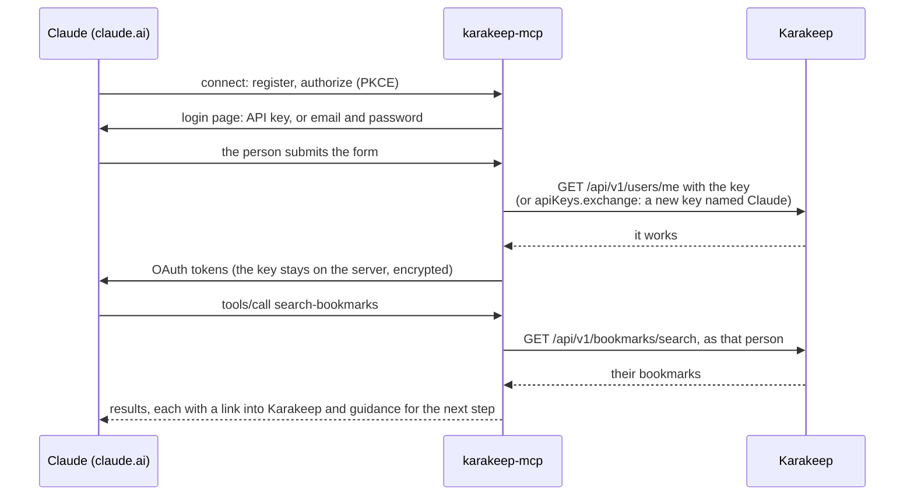

---
hide:
  - toc
---

# Your Karakeep bookmarks, for Claude

An MCP server in front of <a href="https://karakeep.app">Karakeep</a>. Each person signs in once from claude.ai, the Claude apps or Claude Code, with their own Karakeep API key, and Claude searches, reads, saves and tags their bookmarks as them, and only theirs.

[Run it](getting-started.md){ .md-button .md-button--primary }
[Connect Claude](connecting.md){ .md-button }

## How it works

- **[30 tools](tools.md)**: bookmarks, lists, tags, highlights and asset links, named as in Karakeep's own MCP server.
- **[Each person as themselves](security.md)**: the login is the person's own Karakeep key; the server holds no key of its own.
- **[Not Karakeep's own MCP server](adr/0001-own-server-instead-of-upstreams-stdio-one.md)**: that one speaks only stdio and acts as one user per process.

